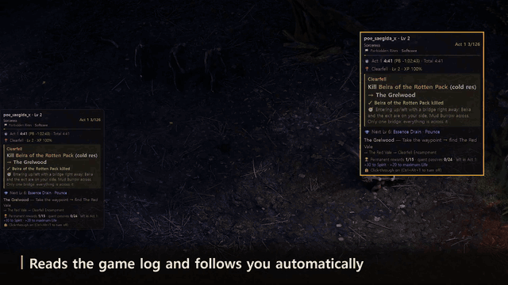
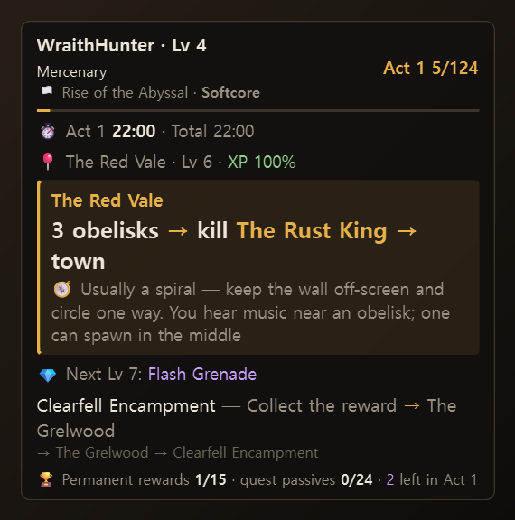
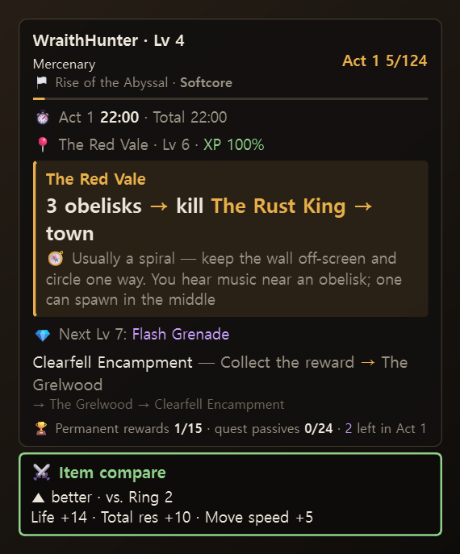
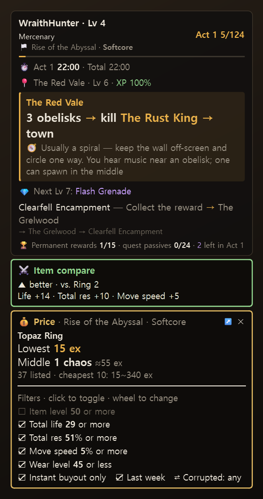
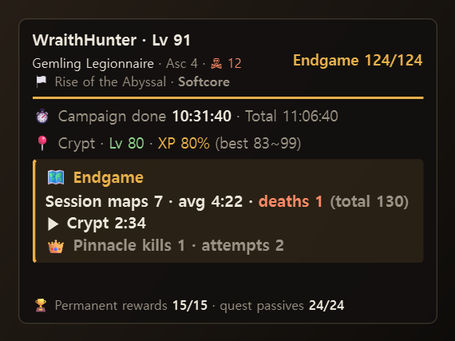

# POE2 Saegida

**A campaign guide overlay — it reads the game's log file, never the game's memory**

*Saegida* (새기다, "sae-gi-da") is Korean for *to engrave* — it keeps your progress, rewards and records engraved so nothing slips.

[한국어](README.md) · **English**

An overlay that shows **what to do next** in the Path of Exile 2 campaign, in a corner of your game screen.
It only reads the log file the game writes, so it follows the character you log in with and the areas you enter.
You don't press anything to advance the guide.

**30-second intro video** — auto progress · boss fights · vendor regex · splits · completion card

https://github.com/user-attachments/assets/2c27bfc5-b0f1-4ccb-b99c-745cacdffff7

[Download in 1080p](https://github.com/ktu0216/poe2-saegida/releases/download/v0.2.0/saegida-intro-en.mp4)

## What it does

| | |
|---|---|
| **Auto-advancing guide** | The guide step follows you as you change areas. Quick town visits are ignored, and it won't move past a step until its boss is dead. |
| **Boss fight tracking** | Boss lines mark the fight start, phases and the kill; during a fight the panel shrinks to one line. |
| **Permanent rewards & quest passives** | Which campaign rewards (resistances, spirit, life…) and how many of the 24 quest passive points you have, and what is still left in this act. |
| **Zone layout tips 🧭** | Short "follow the wall clockwise" style hints for each area. |
| **XP efficiency** | Experience penalty from your level vs. the area level. |
| **Act split timer** | Time per act and the difference to your best previous character (PB). |
| **Item compare** | Ctrl+C a piece of gear in game and see if it beats what you are wearing. |
| **Price check 💰** | Ctrl+V within 2 s after Ctrl+C — lowest and middle trade prices (with exalted equivalents); toggle filters on the card. |
| **Gem guide** | Reads the build linked in the in-game Build Planner and shows the skills and supports for your level, and what unlocks next. |
| **Completion card · LiveSplit** | Finish the campaign and a shareable card (PNG) with your act times is saved; splits export to a LiveSplit file. |
| **Endgame log** | For characters that finished the campaign: maps this session, average time, deaths, pinnacle boss attempts and kills. |
| **English / 한국어** | Works with the Steam/GGG (English) and Kakao (Korean) clients. The screen language can be chosen separately. |

<table>
<tr>
<td> Campaign</td>
<td> Item compare (Ctrl+C)</td>
</tr>
<tr>
<td> Price check (Ctrl+C → Ctrl+V)</td>
<td> Endgame log</td>
</tr>
</table>

## Getting started

1. Download **`poe2-saegida-setup-*.exe`** (installer) from [Releases](../../releases) and run it.
   - Installs for your account only, no admin rights. Creates a Start menu shortcut, and optionally a desktop icon and "Start with Windows".
   - To update, run the new installer over the old one. Settings and progress are kept.
   - Prefer no install? Unzip `poe2-saegida-*-portable.zip` anywhere and run `poe2-saegida.exe`.

   > [!NOTE]
   > On first launch Windows may show **"Windows protected your PC"**. It appears because this personal project has no code-signing certificate.
   > Click **More info → Run anyway**. To check the download, compare the `sha256:` value next to the file on the release page
   > with PowerShell `Get-FileHash <file>.exe`. All source code is in this repository.

2. Set the game to **Windowed Fullscreen** (borderless). The overlay cannot draw over exclusive fullscreen.
3. Start the overlay. The game log is found automatically.
4. Log in and change area — the character and guide position are picked up on their own.

Uninstall from Windows **Settings → Apps**. Settings and progress (`%APPDATA%\poe2-saegida`) are kept; delete that folder too for a full removal.

On the first run it reads your whole log, so earlier characters' progress and splits come back too (a few seconds).

## Basic controls

| Key | Action |
|---|---|
| `Ctrl+Alt+→` / `←` | Next / previous step (if auto-advance got it wrong) |
| `Ctrl+Alt+R` | Rewards, splits and pinnacle boss list |
| `Ctrl+Alt+G` | Gem card |
| `Ctrl+Alt+T` | Click-through (the mouse passes through the panel) |
| `Ctrl+Alt+H` | Hide / show |
| `Ctrl+C` on gear in game | Item compare (press twice to save it as "what I'm wearing") |

Hover the panel to get `◀ ▶ 🏆 💎 ⚙` icons in the top-right corner. Right-click opens the full menu.
See the **[user manual](docs/MANUAL.en.md)** for everything else.

## Is it safe?

| 🚫 Never | ✅ Instead |
|---|---|
| Reads game memory | Reads only the **log file** the game writes itself (`Client.txt` / `KakaoClient.txt`) |
| Sends input to the game (automation) | Only **shows** things — you press every key yourself |
| Modifies game files or the process | Writes nothing to the game folder |
| Sends game data anywhere | Everything stays on your PC (`%APPDATA%\poe2-saegida`). Network use is limited to the **update check** (asks GitHub for the latest version; can be turned off) and **price checks you trigger** (trade search and exchange, poe.ninja prices — only item modifiers are sent, no account or login) |

The clipboard is read only for item text you copy **while the game window is in front**.

A personal tool, not affiliated with Grinding Gear Games or Kakao Games.

### English client status

Since 0.2.2 the whole campaign (acts 1–4 and interludes 1–3) has been played through on the English client, so
boss names, boss-soon / fight / phase / kill lines and progress markers come from real English logs, as they do for
Korean. If you notice a reward that never ticks or a boss that never shows, please open an issue with the log lines.

## Support

Everything is free and will stay free. If it helped you, ☕ [buy me a coffee on Ko-fi](https://ko-fi.com/saegida).

## License

[MIT](LICENSE) · Notices for bundled components such as Qt/PySide6 (LGPL-3.0): [THIRD-PARTY-NOTICES](THIRD-PARTY-NOTICES.md)

## Credits

- Some zone tips: summarised from [POE2Radar](https://github.com/Sikaka/POE2Radar) `zone_notes.json` (MIT, originally Path of Levelling 2)
- English area and reward names: [poe2db.tw](https://poe2db.tw) (boss names and lines come from real game logs)
- English client log format: documented in [bear421/poe-map-log-viewer](https://github.com/bear421/poe-map-log-viewer) (MIT)
- Gem internal ID → name: [Path of Building (PoE2)](https://github.com/PathOfBuildingCommunity/PathOfBuilding-PoE2) `Data/Gems.lua`
- Some interlude tips: summarised from the [poe2way act guide](https://www.poe2way.com/act-guide/ko)
